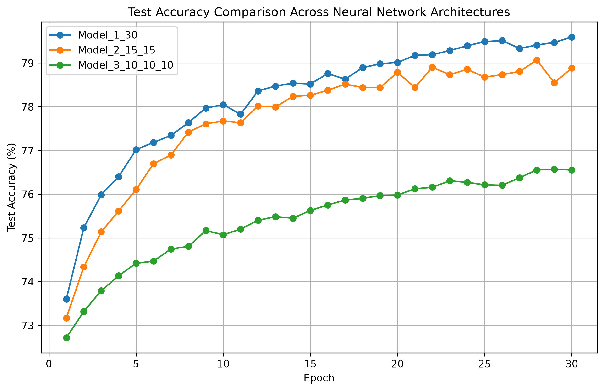
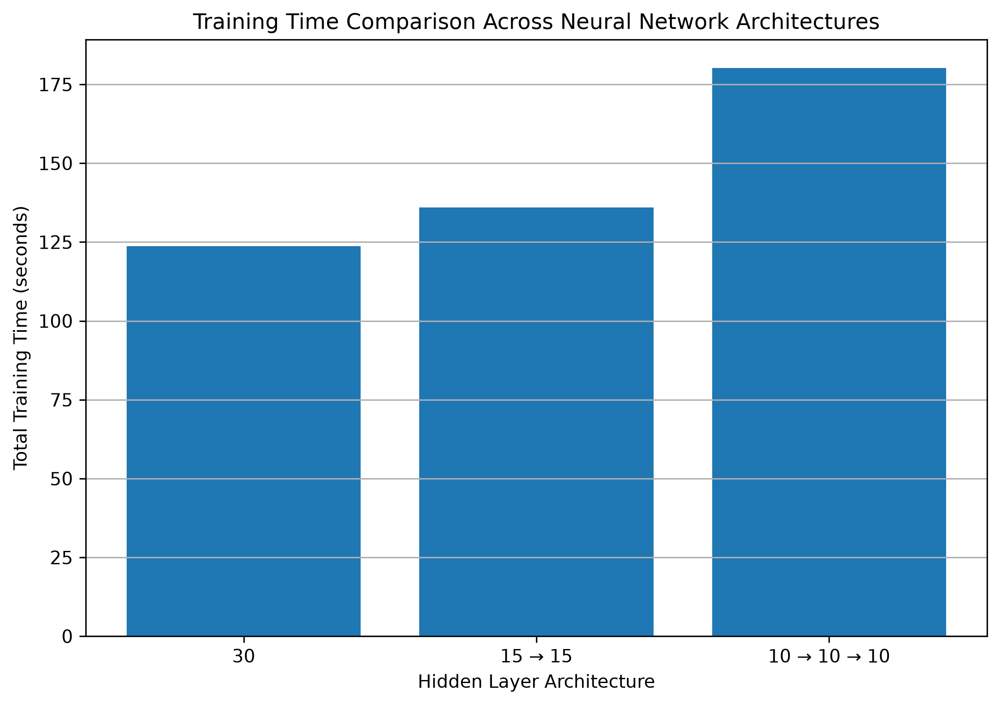

# Lab 5: Neural Network Architecture Experiment

## Objective

The objective of this experiment is to understand how different neural network architectures behave when the total number of hidden nodes remains the same.

Three neural network architectures were compared:

- One hidden layer with 30 nodes
- Two hidden layers with 15 nodes each
- Three hidden layers with 10 nodes each

The experiment compares their accuracy and training time.

---

## Dataset

The **Forest Cover Type dataset** was used for this experiment.

The dataset contains:

- **581,012 samples**
- **54 input features**
- **7 target classes**

The task is to predict the forest cover type based on geographical and environmental features.

The dataset was loaded using Scikit-learn's `fetch_covtype()` function.

---

## Neural Network Architectures

All three models use the same total number of hidden nodes: **30**.

| Model | Architecture | Hidden Layers | Total Hidden Nodes |
|---|---|---:|---:|
| Model 1 | 30 | 1 | 30 |
| Model 2 | 15 → 15 | 2 | 30 |
| Model 3 | 10 → 10 → 10 | 3 | 30 |

Each hidden layer uses the **ReLU activation function**.

The output layer contains **7 nodes**, representing the seven forest cover classes.

---

## Experiment Setup

The following settings were kept the same for all three models:

- Dataset: Forest Cover Type
- Train-test split: 80% training and 20% testing
- Batch size: 256
- Optimizer: Adam
- Learning rate: 0.001
- Loss function: CrossEntropyLoss
- Maximum epochs: 30
- Random seed: 42
- Device: CPU

Feature scaling was performed using `StandardScaler` before training.

---

## Results

The experiment was performed on the complete dataset.

| Model | Architecture | Final Test Accuracy | Training Time |
|---|---|---:|---:|
| Model 1 | 30 | 79.59% | 123.71 seconds |
| Model 2 | 15 → 15 | 78.88% | 135.96 seconds |
| Model 3 | 10 → 10 → 10 | 76.56% | 180.17 seconds |

### Accuracy Comparison



The model with a single hidden layer of 30 nodes achieved the highest final test accuracy.

The two-layer architecture performed slightly worse, while the three-layer architecture had the lowest accuracy.

### Training Time Comparison

### Training Time Comparison



The deeper architectures required more training time.

The single-layer model was the fastest, while the three-layer model took the longest to train.

---

## Observations

The experiment shows that increasing the number of hidden layers does not automatically improve the performance of a neural network.

Even though all three architectures contained the same total number of hidden nodes, their performance was different.

The results show:

1. **Model 1 (30 nodes)** achieved the highest accuracy and trained the fastest.
2. **Model 2 (15 → 15)** achieved slightly lower accuracy and required more training time.
3. **Model 3 (10 → 10 → 10)** achieved the lowest accuracy and required the longest training time.

For this dataset and training configuration, the simpler architecture performed better.

A possible reason is that deeper networks divide the same number of nodes across multiple layers. With only 30 total hidden nodes, each layer in the deeper architectures has fewer nodes available to learn useful feature representations.

---

## Conclusion

This experiment demonstrates that neural network architecture can significantly affect both accuracy and training time, even when the total number of hidden nodes remains constant.

For the Forest Cover Type dataset, the architecture with a single hidden layer containing 30 nodes performed the best among the three tested architectures.

The results suggest that a deeper neural network is not always better. The appropriate architecture depends on the dataset, model capacity, and training configuration.

---

## Project Structure

```text
lab5/
│
├── data/
│
├── output/
│   ├── screenshots/
│   │   ├── accuracy_comparison_full.png
│   │   └── training_time_comparison.png
│   ├── model_comparison.csv
│   ├── model_comparison_full.csv
│   ├── training_history.csv
│   └── training_history_full.csv
│
├── src/
│   ├── neural_network_experiment.py
│   ├── neural_network_full_dataset.py
│   ├── plot_results.py
│   └── plot_training_time.py
│
└── README.md

Generated Output Files
- training_history.csv – Training results from the initial 100,000-sample experiment.
- model_comparison.csv – Summary of the initial experiment.
- training_history_full.csv – Training results from the complete dataset experiment.
- model_comparison_full.csv – Final comparison of all three architectures.
- accuracy_comparison_full.png – Graph comparing test accuracy across epochs.
- training_time_comparison.png – Graph comparing the total training time of each architecture.