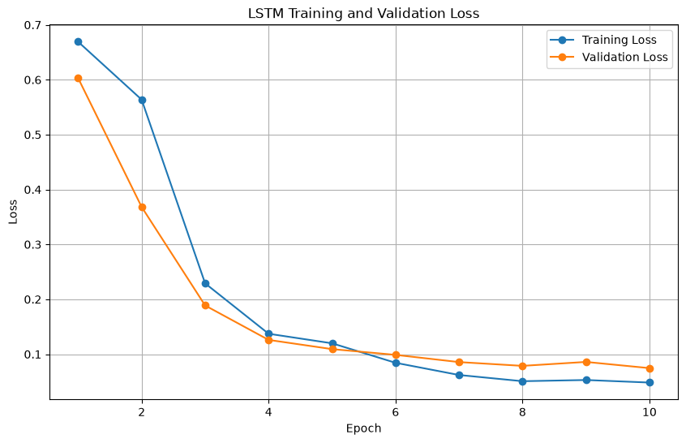
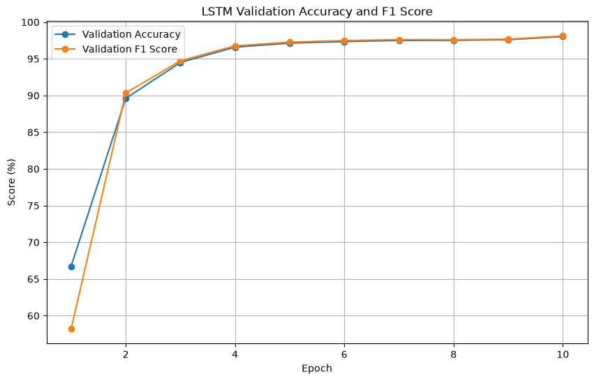

# Lab 7: Phishing Email Detection Using LSTM

## Objective

The objective of this experiment is to perform a text classification task using a Long Short-Term Memory (LSTM) neural network.

The selected task is **phishing email detection**, where the model classifies an email as either phishing/fraudulent or legitimate based on its text content.

This experiment will later be compared with a Transformer-based model in Lab 8 using the same problem.

---

## Problem Statement

Phishing emails are commonly used to deceive users into sharing sensitive information or performing harmful actions. Automatically identifying suspicious emails is an important cybersecurity problem.

In this experiment, an LSTM-based deep learning model was trained to analyze email text and classify it into one of two categories:

- **Label 0:** Legitimate email
- **Label 1:** Phishing/Fraudulent email

---

## Dataset

The dataset used for this experiment contains email text and binary labels.

### Dataset Details

| Property | Value |
|---|---:|
| Total samples | 82,486 |
| Input column | `text_combined` |
| Number of classes | 2 |
| Labels | 0 and 1 |

The dataset contains a combination of legitimate and phishing/fraudulent email samples.

---

## Model Architecture

The LSTM model consists of the following layers:

```text
Input Email Text
        │
        ▼
Text Tokenization
        │
        ▼
Embedding Layer
Vocabulary Size: 20,000
Embedding Dimension: 128
        │
        ▼
LSTM Layer
Hidden Units: 128
        │
        ▼
Linear Classifier
        │
        ▼
Phishing / Legitimate

The embedding layer converts words into numerical vector representations. The LSTM processes the sequence of words and learns patterns from the email text. Finally, the linear classifier produces the prediction.

---

## Training Setup

The model was trained using PyTorch.

| Parameter | Value |
|---|---:|
| Vocabulary Size | 20,000 |
| Embedding Dimension | 128 |
| LSTM Hidden Units | 128 |
| Number of Epochs | 10 |
| Device | CPU |

CUDA was not available in the environment, so the experiment was trained using the CPU.

---

## Training Results

The model improved significantly during the first few epochs.

- Validation accuracy increased from approximately **66.7% in Epoch 1** to approximately **94.5% by Epoch 3**.
- Performance continued to improve gradually and reached approximately **98% by Epoch 10**.
- The validation F1 score closely followed the validation accuracy, indicating strong overall classification performance.

### Training and Validation Loss



### Validation Accuracy and F1 Score



---

## Final Test Results

The final model was evaluated on the test dataset.

| Metric | Result |
|---|---:|
| Test Accuracy | **98.02%** |
| Precision | **97.64%** |
| Recall | **98.57%** |
| F1 Score | **98.10%** |
| Training Time | **1798.68 seconds (~30 minutes)** |

---

## Observations

1. The LSTM model achieved strong performance, with a final test accuracy of **98.02%**.
2. The model learned quickly during the first few epochs, reaching approximately **94.5% validation accuracy by Epoch 3**.
3. The improvement became smaller during the later epochs as the model performance started to stabilize around 97–98%.
4. The high F1 score of **98.10%** shows that the model performed well in balancing precision and recall.
5. Training on the CPU took approximately **30 minutes**, which will provide a useful computational comparison when the same task is performed using a Transformer model in Lab 8.

---

## Project Structure

```text
lab6/
│
├── data/
│   ├── raw/
│   │   └── phishing_email.csv
│   └── processed/
│
├── output/
│   ├── screenshots/
│   │   ├── lstm_loss_comparison.png
│   │   └── lstm_accuracy_f1.png
│   ├── lstm_training_history.csv
│   └── lstm_final_results.csv
│
├── src/
│   ├── train_lstm.py
│   ├── plot_lstm_results.py
│   └── plot_lstm_performance.py
│
└── README.md

Conclusion
This experiment successfully demonstrated the use of an LSTM neural network for phishing email detection.

The model achieved 98.02% test accuracy and an F1 score of 98.10%, showing that LSTMs can effectively learn patterns from email text for this classification task.

In Lab 7, the same phishing detection problem will be solved using a pre-trained open-source Transformer model. The results will then be compared based on classification performance and computational requirements.