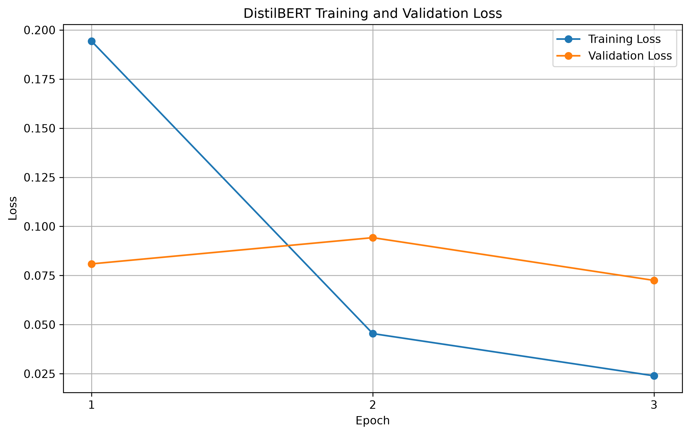
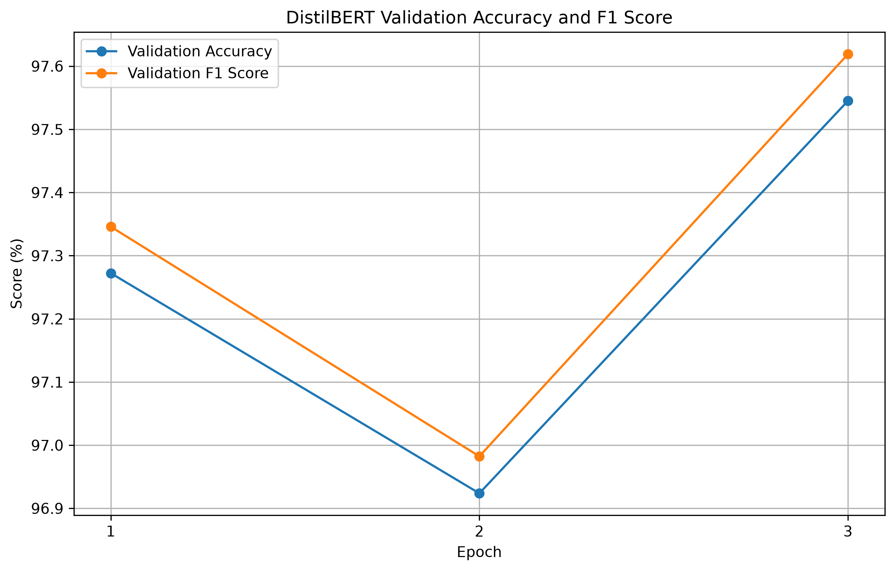

# Lab 7: Phishing Email Detection Using DistilBERT

## Objective

The objective of this experiment is to use a pre-trained open-source Transformer model to solve the same text classification problem performed using an LSTM in the previous experiment.

The selected task is **phishing email detection**, where the model classifies an email as either legitimate or phishing/fraudulent based on its text content.

The Transformer-based results are compared with the LSTM experiment in terms of classification performance and computational requirements.

---

## Problem Statement

Phishing emails are commonly used to deceive users into revealing sensitive information or performing harmful actions. Automatically identifying suspicious emails is an important cybersecurity problem.

In this experiment, a pre-trained DistilBERT Transformer model was fine-tuned to classify email text into two categories:

- **Label 0:** Legitimate email
- **Label 1:** Phishing/Fraudulent email

---

## Dataset

The same phishing email dataset used in the LSTM experiment was used for this experiment.

### Dataset Details

| Property | Value |
|---|---:|
| Total samples | 82,486 |
| Samples after cleaning | 82,485 |
| Input column | `text_combined` |
| Number of classes | 2 |
| Labels | 0 and 1 |

The original dataset was split into training, validation, and testing data using stratified sampling.

| Dataset Split | Samples |
|---|---:|
| Training | 59,389 |
| Validation | 6,599 |
| Testing | 16,497 |

---

## Why DistilBERT?

DistilBERT was selected as the Transformer model because it is a smaller and more computationally efficient version of BERT.

It provides pre-trained language understanding while requiring fewer computational resources than the original BERT model.

For this experiment, the following pre-trained model was used:

```text
distilbert-base-uncased

```

The model contains approximately **66.9 million parameters**.

---

## Model Workflow

The overall workflow of the Transformer-based phishing detection system is:

```text
Input Email Text
        |
        v
DistilBERT Tokenizer
        |
        v
Token IDs + Attention Masks
        |
        v
Pre-trained DistilBERT Model
        |
        v
Classification Layer
        |
        v
Legitimate / Phishing Prediction
```

The DistilBERT tokenizer converts the input email text into token IDs that can be processed by the model. Attention masks are used to indicate which tokens contain actual text and which positions are padding.

The pre-trained DistilBERT model processes the text and uses its previously learned language representations to identify patterns relevant to phishing email detection. The classification layer is then fine-tuned for the binary classification task.

---

## Training Configuration

The model was trained using PyTorch and the Hugging Face Transformers library.

| Parameter | Value |
|---|---:|
| Model | `distilbert-base-uncased` |
| Maximum Sequence Length | 128 |
| Batch Size | 16 |
| Learning Rate | 2e-5 |
| Number of Epochs | 3 |
| Training Samples Used | 5,000 |
| Device | CPU |

---

## Computational Challenge and Optimization

The initial training attempt used a larger training configuration. However, fine-tuning DistilBERT on the CPU was computationally expensive and required a significant amount of time.

The first attempt used a larger training subset and resulted in slow training progress. Since the experiment was performed in a CPU-only environment, the configuration was optimized to make the experiment practical while still demonstrating Transformer fine-tuning.

The following changes were made:

- The training subset was reduced to **5,000 representative samples**.
- The maximum sequence length was reduced to **128 tokens**.
- The batch size was set to **16**.
- The model was trained for **3 epochs**.

The validation and test datasets were retained at their original sizes. This approach allowed the model to be trained within the available computational resources while evaluating its performance on a large validation and test set.

This optimization is documented to maintain transparency regarding the computational limitations and experimental setup.

---

## Training Results

The DistilBERT model achieved strong validation performance during fine-tuning.

| Epoch | Train Loss | Validation Loss | Validation Accuracy | Validation F1 |
|---|---:|---:|---:|---:|
| 1 | 0.1943 | 0.0809 | 97.27% | 97.35% |
| 2 | 0.0454 | 0.0943 | 96.92% | 96.98% |
| 3 | 0.0239 | 0.0725 | 97.55% | 97.62% |

The model achieved its best validation performance during the third epoch.

### Training and Validation Loss



### Validation Accuracy and F1 Score



---

## Final Test Results

The final model was evaluated using the test dataset containing **16,497 samples**.

| Metric | Result |
|---|---:|
| Test Loss | 0.0843 |
| Test Accuracy | **97.22%** |
| Precision | **98.13%** |
| Recall | **96.50%** |
| F1 Score | **97.31%** |
| Training Time | **4188.74 seconds (~69.8 minutes)** |

---

## Comparison with LSTM

The same phishing email classification problem was previously solved using an LSTM model.

| Metric | LSTM | DistilBERT |
|---|---:|---:|
| Test Accuracy | **98.02%** | **97.22%** |
| Precision | 97.64% | **98.13%** |
| Recall | **98.57%** | 96.50% |
| F1 Score | **98.10%** | 97.31% |
| Training Time | ~30 minutes | ~70 minutes |
| Training Data | Full training dataset | 5,000 sample subset |
| Model Type | LSTM | Pre-trained Transformer |

The LSTM achieved slightly higher performance in this experiment. However, the comparison should be interpreted carefully because the DistilBERT model was fine-tuned using only a **5,000-sample training subset** due to CPU computational limitations.

DistilBERT also has a significantly larger and more complex architecture, with approximately **66.9 million parameters**, compared with the smaller custom LSTM model.

---

## Observations

1. DistilBERT achieved strong performance, with a final test accuracy of **97.22%** and an F1 score of **97.31%**.
2. The model achieved high validation accuracy after fine-tuning on only **5,000 training samples**.
3. Fine-tuning a Transformer model on a CPU was significantly more computationally expensive than training the LSTM.
4. The optimized configuration was necessary to make the experiment practical in a CPU-only environment.
5. The LSTM achieved slightly better test performance in this experiment and required less training time.
6. DistilBERT benefits from pre-trained language representations, while the LSTM learned patterns directly from the training dataset.

---

## Project Structure

## Project Structure

```text
lab7/
│
├── data/
│   └── processed/
│
├── output/
│   ├── screenshots/
│   │   ├── distilbert_accuracy_f1.png
│   │   └── distilbert_loss_comparison.png
│   ├── distilbert_final_results.csv
│   └── distilbert_training_history.csv
│
├── src/
│   ├── train_distilbert.py
│   └── plot_distilbert_results.py
│
└── README.md
```

---

## Conclusion

This experiment successfully demonstrated the use of a pre-trained Transformer model for phishing email detection.

DistilBERT achieved a final test accuracy of **97.22%** and an F1 score of **97.31%**. Despite being trained on only a **5,000-sample subset**, the model demonstrated strong classification performance.

The experiment also highlighted an important practical consideration: Transformer models can be significantly more computationally expensive to fine-tune than smaller deep learning models, particularly in a CPU-only environment.

The comparison with the previous LSTM experiment provides insight into the trade-off between model complexity, computational requirements, and classification performance.